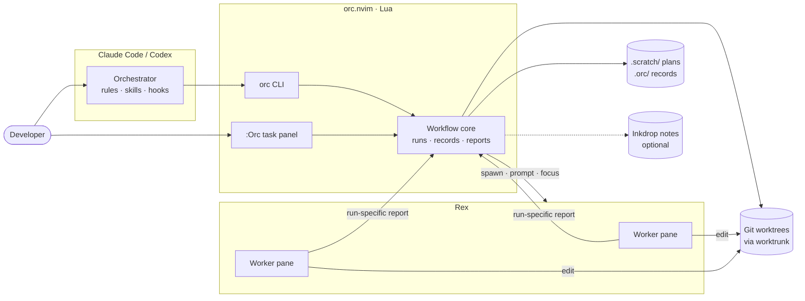

# orc.nvim

Visible, isolated multi-agent coding for Neovim, [Rex](https://www.superlogical.com/rex/docs),
Claude Code and Codex.

One orchestrator agent scopes, delegates, reviews and ships. Implementers work in
separate Git worktrees inside Rex terminals you can watch and steer. Neovim shows
the live task panel. Nothing is accepted until the orchestrator reads the diff and
reruns validation.

Everything — CLI, hooks, generator, tests and evals — is Lua running on Neovim's
runtime (`nvim -l`). It does not load your Neovim configuration and has no Node
backend.

## Architecture



- **Harness** makes decisions from canonical Markdown roles, rules and skills.
- **orc** owns identities (`runId`), worktrees, subprocesses and report validation.
- **Rex** owns terminal processes, layout and events. Workers outlive the UI.
- **Neovim** renders state and calls the same workflow asynchronously.

Details: [architecture](docs/architecture.md) · [Rex integration](docs/rex-integration.md).

## Requirements

- Neovim 0.11+, Git and [worktrunk](https://worktrunk.dev).
- Claude Code or Codex.
- [Rex](https://www.superlogical.com/rex/docs) for pane and pair workers.
- Optional: [ghq](https://github.com/x-motemen/ghq) and
  [snacks.nvim](https://github.com/folke/snacks.nvim) for `:Orc projects`;
  curl for the Inkdrop local-server integration.
- Development: StyLua 2.6 and Neovim's Lua Tree-sitter parser.

## Installation

Clone once and put `bin` on PATH (fish shown):

```fish
git clone https://github.com/crafts69guy/orc.nvim ~/.local/share/orc.nvim
fish_add_path ~/.local/share/orc.nvim/bin
orc doctor
```

Neovim (lazy.nvim):

```lua
{ "crafts69guy/orc.nvim", cmd = "Orc", opts = {} }
```

Register the checkout as a plugin marketplace for each harness you use:

```fish
claude plugin marketplace add ~/.local/share/orc.nvim
claude plugin install orc@orc-nvim
codex plugin marketplace add ~/.local/share/orc.nvim
codex plugin add orc@orc-nvim
```

The CLI also loads the local Claude plugin explicitly. Restart agent sessions and
approve new or changed hooks through the harness's normal trust controls before
relying on hook-driven automation. `orc update` fast-forwards the clean checkout
and updates the installed plugins.

## Commands

| Command | Purpose |
| --- | --- |
| `orc claude`, `orc codex` | Start an orchestrator with shared rules and approved lessons |
| `orc claude --pair` | One Codex worker beside the orchestrator in Rex |
| `orc claude --panes`, `orc codex --panes` | Force pane delegation (automatic inside Rex) |
| `orc claude --no-panes`, `orc codex --no-panes` | Disable automatic pane mode |
| `orc wt new\|merge\|remove\|list\|session` | Manage isolated worktrees and serial merges |
| `orc pane start\|wait\|prompt\|close [--force]` | Manage a worker and its report; `close --force` marks an unreachable record closed without calling Rex |
| `orc pane prune --path <dir>` | Close successful exits or idle/done workers with a matching done report and evidence; print closed/skipped JSON |
| `orc status --json` | Feature/task/worker snapshot, also usable outside Rex |
| `orc doctor --json` | Prerequisite and integration checks |
| `orc context --scope all --json` | Audit static Claude/Codex context sources |
| `orc inkdrop init\|inbox\|claim\|push\|pull\|lessons` | Mirror managed feature blocks and approved lessons |
| `orc inkdrop-mcp` | Explicit shared Inkdrop service setup, migration and lifecycle |
| `orc completion fish` | Print fish completion definitions |
| `orc eval` | Explicitly run model-based behavior evaluations |
| `orc update` | Fast-forward the clean Git checkout and update installed plugins |

Run `orc --help` for arguments.

Inside Rex (`REX_SESSION` and `REX_BLOCK` set), pane mode turns on automatically
unless pair mode, `--no-panes`, or `ORC_PANES=0` applies. `--panes` or `ORC_PANES=1`
forces it; `--panes` conflicts with `--no-panes`. Start workers with
`orc pane start <feature> <task> --path <checkout> --brief <file>`: Codex and
`--role implementer` are defaults. Use `--role scoper` for read-only scoping or
`--kind claude` for Claude. Scopers return reports in their final message; the
Stop hook saves a matching Run report when its file is absent.

In pane mode, scopers and implementers use Codex pane workers; reviewers and
shippers stay native. For one task add `--here` in the session checkout and
do not edit beside its implementer. Parallel tasks use dispatch worktrees.
Run `orc pane wait` with the harness's background execution. If the worker prompt
is still unacknowledged after 60 s (for example untrusted hooks in Codex), wait
returns `unacknowledged` with a hint instead of running to timeout. Prune uses the same
ownership/process checks as non-force close and a lock per task across the repository.

**Safety defaults:** permission bypass is explicit (`--yolo`), never the default.
Workers must not commit or push. A terminal's `done` indicator is not validation —
review the diff and rerun checks before accepting a task.

## Neovim

- `:Orc` opens the task panel: features, tasks and workers (including pair
  workers without a plan). Open a task's brief, report or diff, focus its Rex
  pane, or send a follow-up. Closing the panel stops only its watchers; workers
  keep running and state is rebuilt from disk and Rex on reopen.
- `:Orc projects` searches `ghq list -p` in a compact Snacks picker and opens a
  fresh Rex session for the selected repository. LazyVim already ships snacks.nvim.

Rex actions can open either view in a floating Neovim and pass the originating app
for session selection. See [Rex integration](docs/rex-integration.md).

## State and integrations

- Plans and capture logs live in the main checkout's `.scratch/<feature>/`.
  Approved lessons and worker records live in `.orc/`, excluded from Git.
- Every assignment has a `runId`; reports must identify it. An unconfirmed
  delivery is never resent automatically, and a failed follow-up never erases the
  previous report.
- `status`, `doctor` and `context` emit `schemaVersion: 1` JSON. New fields are
  additive; consumers should ignore unknown fields and keep the distinction
  between `null`, empty arrays and empty objects. Each task carries a `state`
  (merged, agent, report status, `worktree` or `pending`); plain-text `orc status`
  prints it. A worker report counts only with `Status:` (`done|partial|blocked`)
  and a nonempty `Validation`; markdown bold labels are accepted.

**Inkdrop** (optional) reads `INKDROP_LOCAL_USERNAME`, `INKDROP_LOCAL_PASSWORD`
and `INKDROP_LOCAL_SERVER_URL` (default `http://localhost:19840`). Keep
credentials in an untracked local file. Only loopback HTTP is accepted, redirects
are refused, and only the managed `<!-- orc:begin -->` block is replaced. For an
opt-in LaunchAgent shared by Claude, Codex and Rex workers, see
[shared Inkdrop MCP](docs/shared-inkdrop.md).

## Development

```fish
nvim --clean -l test/run.lua
nvim --clean -l test/run.lua --coverage
nvim --clean -l scripts/gen-agents.lua --check
stylua --check lua test scripts bin/orc plugin evals
```

Tests use fake process/network adapters and temporary repositories; they never
call a model or need a Rex server. Coverage has separate 98% gates for lines,
branches and functions ([definitions](docs/coverage.md)).

Paid evaluations are separate: `orc eval` enforces a model cost cap
(`ORC_EVAL_MAX_COST`, default 5 USD).

### Worktrunk project hooks

Use project hooks in `.config/wt.toml` as the deterministic gate before agent
review. For this project's validation, the recommended configuration is:

```toml
[pre-merge]
validate = """
nvim --clean -l test/run.lua --coverage &&
nvim --clean -l scripts/gen-agents.lua --check &&
stylua --check lua test scripts bin/orc plugin evals
"""

[post-start]
copy = "wt step copy-ignored"
```

With project hooks approved, `orc wt merge` refuses a failing `pre-merge` check.
Approve them before relying on the gate: declining approval skips project hooks.
`post-start` runs in the background when a worktree is created; `copy-ignored`
copies ignored build caches and dependencies from the primary worktree. Limit
copies to intended caches with `.worktreeinclude`.

Verified with Worktrunk v0.81.0 (`wt --help`, `wt hook --help`,
`wt step copy-ignored --help`) and the official
[hook](https://worktrunk.dev/hook/) and
[copy-ignored](https://worktrunk.dev/step/#wt-step-copy-ignored) documentation.

See also [cutover](docs/cutover.md) for migrating from the earlier Orchestra plugin.

## License

[MIT](LICENSE)
