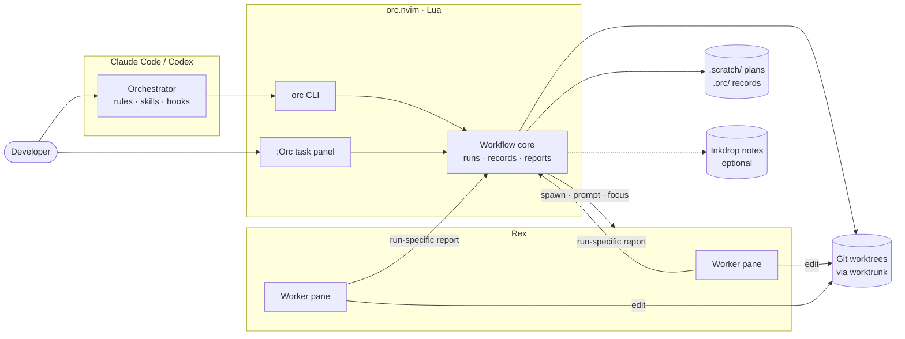

# orc.nvim

Visible, isolated multi-agent coding for Neovim, [Rex](https://www.superlogical.com/rex/docs),
Claude Code and Codex.

One orchestrator agent scopes, delegates, reviews and ships. Implementers work in
separate Git worktrees inside Rex terminals you can watch and steer. Neovim shows
the live task panel. Nothing is accepted until the orchestrator reads the diff and
reruns validation.

Everything — CLI, hooks, generator, tests and evals — is Lua running on Neovim's
runtime (`nvim -l`). It does not load your Neovim configuration and has no Node
backend.

## Architecture



- **Harness** makes decisions from canonical Markdown roles, rules and skills.
- **orc** owns identities (`runId`), worktrees, subprocesses and report validation.
- **Rex** owns terminal processes, layout and events. Workers outlive the UI.
- **Neovim** renders state and calls the same workflow asynchronously.

Details: [architecture](docs/architecture.md) · [Rex integration](docs/rex-integration.md).

## Requirements

- Neovim 0.11+, Git and [worktrunk](https://worktrunk.dev).
- Claude Code or Codex.
- [Rex](https://www.superlogical.com/rex/docs) for pane and pair workers.
- Optional: [ghq](https://github.com/x-motemen/ghq) and
  [snacks.nvim](https://github.com/folke/snacks.nvim) for `:Orc projects`;
  curl for the Inkdrop local-server integration.
- Development: StyLua 2.6, lua-language-server 3.19.2 and Neovim's Lua Tree-sitter parser.
  The LuaLS check is verified with LuaLS 3.19.2 and Neovim 0.12.6. Neovim's runtime
  supplies the `vim` types, so upgrading either can add diagnostics without a code change.

## Installation

Clone once and put `bin` on PATH (fish shown):

```fish
git clone https://github.com/crafts69guy/orc.nvim ~/.local/share/orc.nvim
fish_add_path ~/.local/share/orc.nvim/bin
orc doctor
```

Neovim (lazy.nvim):

```lua
{ "crafts69guy/orc.nvim", cmd = "Orc", opts = {} }
```

Register the checkout as a plugin marketplace for each harness you use:

```fish
claude plugin marketplace add ~/.local/share/orc.nvim
claude plugin install orc@orc-nvim
codex plugin marketplace add ~/.local/share/orc.nvim
codex plugin add orc@orc-nvim
```

The CLI also loads the local Claude plugin explicitly. Restart agent sessions and
approve new or changed hooks through the harness's normal trust controls before
relying on hook-driven automation. `orc update` fast-forwards the clean checkout
and updates the installed plugins.
After `orc update` changes hooks, re-trust them in Codex's `/hooks` before
workers can be acknowledged.

The `UserPromptSubmit` context hook warns the main agent when the latest input
usage reaches `ORC_CONTEXT_WARN` tokens (default `200000`; `0` disables it;
invalid values use the default). It reads only the last 512 KiB of a Claude
transcript or Codex rollout and ignores sidechains and workers (`ORC_ROLE` set).
At task boundaries, log progress in `.scratch/<feature>/log.md`, then `/clear`
and resume from the plan and log; use `/compact <focus>` mid-task.

Fresh orchestrator context from the Codex launcher or the SessionStart hook
includes the startup routing rule and its provenance. Make small, low-risk edits
directly when targeted checks can verify them. Before delegating, read the
absolute workflow guide path printed in the session context. The guide comes
from the same Orc runtime and loads on demand.

[Plan](skills/plan/SKILL.md) fills gaps in the brief's done-evidence and runs
small in-scope experiments when they can settle a technical tradeoff. To revise
the prompt before planning, call [sharpen](skills/sharpen/SKILL.md) with
`/orc:sharpen` in Claude Code or select `orc:sharpen` from the `$` menu in Codex.
This explicit-only skill returns a revised prompt with primary sources, a method
and an independent check. It can propose a prototype within the task's scope
and leaves product and preference decisions to you.

## Commands

| Command | Purpose |
| --- | --- |
| `orc claude`, `orc codex` | Start an orchestrator with shared rules and approved lessons |
| `orc claude --pair` | One Codex worker beside the orchestrator in Rex |
| `orc claude --panes`, `orc codex --panes` | Force pane delegation (automatic inside Rex) |
| `orc claude --no-panes`, `orc codex --no-panes` | Disable automatic pane mode |
| `orc wt new\|merge\|apply\|remove\|list\|session` | Manage isolated worktrees and serial merges; `apply` stages a task in the current checkout without committing on base; re-running it after a fix round stages only the delta; `new` reuses live task worktrees; a merge whose cleanup fails still reports `merged` with a `warning` |
| `orc pane start\|wait\|prompt\|close [--force] [--no-review \| --review <file>]` | Manage a worker and its report. Close a live TUI implementer with a done self-review or an accepted independent review at the pinned `--review` path. Close accepts a matching fingerprint or a comment-only deletion in `.ts`, `.mts`, `.cts`, or `.lua` files when HEAD and staged changes match the review. For comment deletions, close also requires the same code before and after in every touched file, comparing stripped Lua bytecode or TypeScript code tokens. Use `--no-review` for an abandoned, stalled or failed task, an unavailable review skill, or a non-risky fix round the orchestrator verified. Record the reason in the task log. `--force` marks an unreachable record closed without calling Rex. |
| `orc pane prune --path <dir>` | Close successful exits or idle/done workers with a matching done report and evidence, skipping unreviewed live TUI implementers; print closed/skipped JSON with reasons |
| `orc pane start ... [--allow-subdir] [--precheck '<cmd>']` | Require a checkout toplevel by default; check prerequisites before pane creation |
| `orc pane start ... [--mcp <name,...>]` | Workers start no MCP servers, configured or Codex-plugin, unless allowlisted; a Codex worker refuses to launch if Codex rejects the overrides or would still start one; the orchestrator keeps its own |
| `orc pane prompt ... --queue` | Queue follow-ups on acknowledged working TUI workers; await hook acknowledgment |
| `orc pane review <task> --path <dir> [--skill ponytail-review\|ponytail-audit] [--target <range\|paths>]` | Send an idle TUI worker a read-only review of its uncommitted diff (else `<base>...HEAD`). `pane wait` reports whether the checkout changed. Recheck fix-round paths with `--target` unless a new risky area requires independent review. |
| `orc pane review-begin <task> --path <dir> --review <new-file>` | Pin the current run and checkout before independent review. Save the review output at that path, read its verdict, then pass the same path to `pane close --review`. |
| `orc pane wait ... --until report` | Wait for a matching report, user-action block, exit/error, 60 seconds without prompt acknowledgment, five idle minutes without a report, or timeout. Returns `stalled` with a recovery hint when a working TUI transcript is unchanged for 30+ minutes. A done report adds `next` with `pane review` for a TUI implementer's work run or the close command in other cases. Follows new runs and lists replaced ones in `previousRuns`. Failures return `state: "wait-failed"` with a `hint`. |
| `orc pane pause <task> --path <dir>` | Interrupt a working TUI worker with Esc (or record a manual Esc); resume with `orc pane prompt` |
| `orc gate [--label <name>] [--log <file>] -- <cmd...>` | Serialize heavy commands across the machine; stream output and optionally save a log |
| `orc status --json` | Feature/task/worker snapshot with warnings for shared stash entries, unclaimed task worktrees, and features ready to archive. Also usable outside Rex. |
| `orc doctor --json` | Prerequisite and integration checks |
| `orc context --scope all --json` | Audit static Claude/Codex context sources and report the invoked Orc runtime's rule provenance |
| `orc inkdrop init\|inbox\|claim\|push\|pull\|lessons` | Mirror managed feature blocks and approved lessons |
| `orc inkdrop-mcp` | Explicit shared Inkdrop service setup, migration and lifecycle |
| `orc completion fish` | Print fish completion definitions |
| `orc eval` | Explicitly run model-based behavior evaluations |
| `orc update` | Fast-forward the clean Git checkout and update installed plugins |

Run `orc --help` for arguments.

Choose `--level default|high|max` (or `ORC_LEVEL`; the flag wins):

| Level | Routing after deterministic checks |
| --- | --- |
| `default` (Single) | One model review per delegated diff. Use pane self-review for non-risky diffs and independent review for security, concurrency, migrations, public APIs or fund safety. |
| `high` (Cascade) | Escalate kind or Claude model after a failed review round; record why |
| `max` (Critique) | Two independent reviews in parallel where available for every substantial diff, with one combined follow-up to the same implementer. |

Claude `high` and `max` share elevated role models; Codex model selection stays
native. Worker records and picker rows show the level captured at start; older
records show `default`. Prefer the other vendor for independent review. If quota
or unsupported transport prevents it, start a fresh same-vendor reviewer and
record the reason. If none can run, record the blocker and leave independent
review pending. Review and deterministic gates still apply when nothing can run
in parallel. If the implementer hits a usage limit, restart the same brief and
worktree with the other `--kind`.

Reviewers end with a `pass`, `fail` or `inconclusive` verdict, and inconclusive
is not a pass. For risky diffs they name the premise the change's safety rests
on and try to break it, including readers that grep misses. Implementers show a
reproducible bug fix or new check failing before the change and passing after.
When a fix round leaves its finding open, the orchestrator records the shared
assumption of the failed fixes and checks it before the next attempt.

Before any model review of a delegated diff, once the worker is idle, the orchestrator
follows the `no-comments` skill (explicit only, never invoked implicitly), which runs
the `comment-sicko` role with fresh context. It deletes every comment in scope except
legal or license headers; non-obvious behavior forced by an external dependency,
platform, vendor or protocol we cannot reshape; `prettier-ignore` and
`stylua: ignore`; lint suppressions whose rule is faulty, pedantic or style-only;
doc comments that define a public API contract; LuaLS type annotations; and issue
or RFC links that explain a constraint code cannot express. It flags our own
surprising code `MUST KILL` for a rename, extraction or type instead of prose. The
orchestrator merges accepted flags with the review findings into one follow-up and
offers to encode claimed constraints as checks. Roles write no comments outside these
exceptions; this overrides Ponytail's why-comments and `shortcut:` notes.

For `.ts` and `.tsx` work, orc ships pstack's `typescript-best-practices` skill with
its `principle-type-system-discipline` and `principle-boundary-discipline` skills.
As in pstack, all three are explicit-only: Claude honors `disable-model-invocation`,
Codex honors `agents/openai.yaml`, and the TypeScript skill links the principles.
The delegated guide puts the TypeScript skill's path in briefs and review prompts
for tasks that touch `.ts` or `.tsx` files, and `orc pane review` adds it. See
[third-party notices](THIRD_PARTY_NOTICES.md).

Every implementer brief and review prompt names orc's explicit-only
[test-discipline](skills/test-discipline/SKILL.md) skill: protect existing tests,
red before green, brief edge cases, a bounded mutation probe, deterministic tests,
property tests and coverage as a diagnostic. The orchestrator reruns one red claim
itself. Its JavaScript and TypeScript section adapts fast-check's
`javascript-testing-expert` skill. When the root `package.json` lists no
`fast-check`, session context asks the orchestrator to recommend the library once;
it installs it only with the user's approval. The upstream skill is not recommended
because it asks for test comments and self-installs packages, against orc's rules.

Inside Rex (`REX_BLOCK` set), pane mode turns on automatically
unless pair mode, `--no-panes`, or `ORC_PANES=0` applies. `--panes` or `ORC_PANES=1`
forces it; `--panes` conflicts with `--no-panes`. Start workers with
`orc pane start <feature> <task> --path <checkout> --brief <file>`: Codex and
`--role implementer` are defaults. Use `--role scoper` for read-only scoping or
`--kind claude` for Claude. Scopers return reports in their final message; the
Stop hook saves a matching Run report when its file is absent.
Orc uses a non-empty `REX_SESSION` when present and otherwise resolves the session
from `REX_BLOCK` with `rex whoami`.

Choose a worker transport with `--transport tui|exec`:

| Transport | Providers | Trade-off |
| --- | --- | --- |
| `tui` (default, including older records) | Codex, Claude | Interactive steering, approvals, `pane prompt` follow-ups and hook-based reports |
| `exec` (opt-in for bounded one-turn work) | Codex | Headless JSONL events, token usage and start/wait/close |

For example, add `--transport exec` to `orc pane start`. Exec workers save raw
events to `<checkout>/.orc/runs/<runId>.jsonl` and store `threadId`, last-turn
`usage`, `exitCode` and `rateLimited` on the worker record. They retain the same
hook acknowledgement and Markdown report checks. `pane wait` returns
`rate-limited` with a restart hint when an exec error or stderr indicates a quota,
usage or rate limit. Close that worker and restart the same brief and worktree
with `--kind claude --transport tui`. Exec follow-ups currently require closing
and starting a new worker; the saved thread ID is diagnostic metadata, not an
automatic resume. Workers never answer approvals.

In pane mode, scopers and implementers use pane workers (Codex by default).
Independent review follows the vendor preference above and shippers stay native.
For one task add `--here --path <checkout>` and leave the checkout to its
implementer. Starting, closing, or pruning `--here` workers arranges the
orchestrator and its tiled orc workers in an equal grid. If the tiled layer
contains another pane, orc keeps Rex's existing placement. Closing from outside
the worker's tiled window also skips the grid. Parallel tasks use dispatch worktrees.
An implementer owns its checkout until it closes or exits successfully. For a failed
worker, run `orc pane close <task> --path <checkout> --no-review` before starting another
implementer there. If the worker has stopped and its pane is gone, use `--force` to mark its
record closed.
Start requires the checkout's git toplevel; `--allow-subdir` explicitly permits a
subdirectory. `--here` also supports a checkout in another repository.
`--precheck '<cmd>'` runs in `--path` using `sh -c` before creation;
failure returns `precheck-failed`, `exitCode` and the last 40 output lines without
creating a pane or worker record. Check prerequisites that already exist, not a
version bump or export assigned to the worker.

Run `orc pane wait --until report` with the harness's background execution. It
continues through missing-evidence stops until the current run has a report with
Status and Validation, a native user-action block, process exit/error or timeout.
A worker that stays idle without that report for five minutes returns
`turn-ended-no-report` with a hint, because pane workers never resume on their own.
Plain wait reports `turn-ended-no-report` as soon as a turn ends without evidence.
Both wait modes return `unacknowledged` after 60 seconds without prompt
acknowledgment, with `evidence: false`, `report: null` and a hint. Check hook trust
in Codex (`/hooks`) or Claude and look for "Hook failed" messages in the pane.
Prune uses the same ownership/process checks as non-force close and a lock per task
across the repository.
A follow-up (`pane prompt`, with or without `--queue`, or `pane review`) makes its
run current at once. A running wait follows the newest run and restarts the
acknowledgment window. The `previousRuns` array lists each replaced run's `runId`,
`report` (or null) and `status`. Keep one wait running per worker. Wait failures
return `status: "error"`, `state: "wait-failed"`, `stderr` and a `hint`.
`pane prompt --queue` uses Codex Tab or Claude Enter on acknowledged working TUI
workers; `queued` awaits the same UserPromptSubmit acknowledgment as other delivery.
Until then the first turn's Stop keeps only that turn's final-message report, and
both wait modes count the 60-second acknowledgment window only after the running turn ends.
Without `--queue`, busy workers still return `not-sent`. `sent: true` means the
terminal write completed; `status` stays `unconfirmed` until the hook acknowledges it.

To pause, run `orc pane pause <task> --path <dir>`: it sends Esc to a working TUI
worker it owns, waits for the native idle state and records the ended turn, because
an interrupted turn emits no Stop hook. After a manual Esc it only records the idle
turn. It refuses permission or user-action dialogs. Resume with `orc pane prompt`,
which starts a new run with its own report path; never type into the pane by hand.

### Validation profile

Place optional free Markdown in the main checkout's `.orc/validation.md`, beside
`.orc/lessons.md`. Context audits list it as project memory and implementer prompts
tell workers to read it; it overrides the brief's Validate section. Describe three
tiers with concrete commands, for example:

```markdown
# Validation
- edit: run syntax and formatting checks on touched files.
- task: run focused behavior tests for the task.
- gate: run the full suite and coverage once before commit.
```

Workers run only edit and task tiers. After integration, the orchestrator runs the
gate tier once through `orc gate` against the exact tree to be committed. A gate
run covering that tree and the required checks can be reused. `orc gate` preserves
the child exit code, streams stdout/stderr and tees both to `--log` when supplied.
Its lock is `$ORC_GATE_LOCK`, otherwise `${XDG_CACHE_HOME:-~/.cache}/orc/gate.lock`.
The private JSON lock records pid, label, cwd and start time; waiting prints the
holder and age once, then sleeps. Dead owners and owners predating the last boot
by more than five seconds are recovered with a diagnostic. If uptime is unavailable,
live owners are retained.

**Safety defaults:** permission bypass is explicit (`--yolo`), never the default.
Workers must not commit or push. A terminal's `done` indicator is not validation —
review the diff and rerun checks before accepting a task.

## Neovim

- `:Orc` opens the task panel: features, tasks and workers (including pair
  workers without a plan). Open a task's brief, report or diff, focus its Rex
  pane, or send a follow-up. Closing the panel stops only its watchers; workers
  keep running and state is rebuilt from disk and Rex on reopen.
- `:Orc projects` searches `ghq list -p` in a compact Snacks picker and opens a
  fresh Rex session for the selected repository. LazyVim already ships snacks.nvim.

Rex actions can open either view in a floating Neovim and pass the originating app
for session selection. See [Rex integration](docs/rex-integration.md).

## State and integrations

- Plans and capture logs live in the main checkout's `.scratch/<feature>/`.
  `status` lists only `.scratch/<feature>/plan.md`; move finished features to
  `.scratch/.archive/<feature>` to drop them from the snapshot.
  Approved lessons and worker records live in `.orc/`, excluded from Git.
- Every assignment has a `runId`; reports must identify it. An unconfirmed
  delivery is never resent automatically, and a failed follow-up never erases the
  previous report.
- Worker scans skip records whose root or file identity no longer matches; `status`
  lists their file paths in `warnings`. Unreadable or invalid JSON records remain errors.
- `status`, `doctor` and `context` emit `schemaVersion: 1` JSON. New fields are
  additive; consumers should ignore unknown fields and keep the distinction
  between `null`, empty arrays and empty objects. Each task carries a `state`
  (merged, agent, report status, `worktree` or `pending`); plain-text `orc status`
  prints it. Task report status comes from the matching worker's run-specific report,
  never a shared checkout report. A worker report counts only with `Status:` (`done|partial|blocked`)
  and a nonempty `Validation`; markdown bold labels are accepted, and a headed
  `Validation` may hold deeper sub-headings.
- `orc context` reports `orchestratorRule` in JSON and prints the same provenance
  in text. Compare its absolute `path`, CLI `version`, and content `sha256` with
  the values in the fresh session context to identify which Orc runtime supplied
  the session rule. `--scope` filters the Claude/Codex audit findings and sources.
  Runtime provenance and any unscoped `orc` warnings describe the invoked runtime
  independently of that filter. An unreadable rule produces a warning and omits
  the fingerprint.

**Inkdrop** (optional) reads `INKDROP_LOCAL_USERNAME`, `INKDROP_LOCAL_PASSWORD`
and `INKDROP_LOCAL_SERVER_URL` (default `http://localhost:19840`). Keep
credentials in an untracked local file. Only loopback HTTP is accepted, redirects
are refused, and only the managed `<!-- orc:begin -->` block is replaced. For an
opt-in LaunchAgent shared by Claude, Codex and Rex workers, see
[shared Inkdrop MCP](docs/shared-inkdrop.md).

## Development

```fish
nvim --clean -l test/run.lua
nvim --clean -l test/run.lua --coverage
nvim --clean -l scripts/gen-agents.lua --check
stylua --check lua test scripts bin/orc plugin evals
env -u VIMRUNTIME sh -c '
lua_ls_dir=$(mktemp -d "${TMPDIR:-/tmp}/orc-luals.XXXXXX") &&
trap "rm -rf -- \"\$lua_ls_dir\"" EXIT &&
VIMRUNTIME=$(env -u VIMRUNTIME nvim --clean --headless +"lua io.write(vim.env.VIMRUNTIME)" +qa) &&
VIMRUNTIME="$VIMRUNTIME" lua-language-server --check . --checklevel=Warning \
  --metapath="$lua_ls_dir/meta" --logpath="$lua_ls_dir/log"
'
```

Tests use fake process/network adapters and temporary repositories; they never
call a model or need a Rex server. Coverage has separate 90% floors for lines,
branches and functions ([definitions](docs/coverage.md)). They catch untested
modules; they are not a target.

Paid evaluations are separate: `orc eval` enforces a model cost cap
(`ORC_EVAL_MAX_COST`, default 5 USD).

### Worktrunk project hooks

Use project hooks in `.config/wt.toml` as the deterministic gate before agent
review. For this project's validation, the recommended configuration is:

```toml
[pre-merge]
validate = '''
orc gate --label orc-pre-merge -- sh -c '
nvim --clean -l test/run.lua --coverage &&
nvim --clean -l scripts/gen-agents.lua --check &&
stylua --check lua test scripts bin/orc plugin evals &&
lua_ls_dir=$(mktemp -d "${TMPDIR:-/tmp}/orc-luals.XXXXXX") &&
trap "rm -rf -- \"\$lua_ls_dir\"" EXIT &&
VIMRUNTIME=$(env -u VIMRUNTIME nvim --clean --headless +"lua io.write(vim.env.VIMRUNTIME)" +qa) &&
VIMRUNTIME="$VIMRUNTIME" lua-language-server --check . --checklevel=Warning \
  --metapath="$lua_ls_dir/meta" --logpath="$lua_ls_dir/log"
'
'''

[pre-start]
copy = "wt step copy-ignored"
```

With project hooks approved, `orc wt merge` refuses a failing `pre-merge` check.
Approve them before relying on the gate: declining approval skips project hooks.
`pre-start` blocks worktree creation until it finishes, so dependencies exist before
`orc pane start`; `post-start` runs in the background and can race a worker or
`--precheck`. `copy-ignored` copies ignored build caches and dependencies such as
`node_modules` from the primary worktree; a package install (for example
`bun install`) also works. Limit
copies to intended caches with `.worktreeinclude`.

Task worktrees live in `.worktrees/` inside the main checkout, so they inherit the
project's Codex trust and stay within the orchestrator's project directory. Git and
rg skip them through `.git/info/exclude`; tools that walk the tree themselves do not.
Exclude `.worktrees/` from watchers, type checkers and test runners (for example
tsconfig `exclude`, Jest `modulePathIgnorePatterns`, Metro `resolver.blockList`,
ESLint ignores), or the main checkout indexes and runs in-flight tasks, and Metro
reports duplicate modules once `copy-ignored` copies `node_modules`.

Verified with Worktrunk v0.81.0 (`wt --help`, `wt hook --help`,
`wt step copy-ignored --help`) and the official
[hook](https://worktrunk.dev/hook/) and
[copy-ignored](https://worktrunk.dev/step/#wt-step-copy-ignored) documentation.

See also [cutover](docs/cutover.md) for migrating from the earlier Orchestra plugin.

## License

[MIT](LICENSE)
