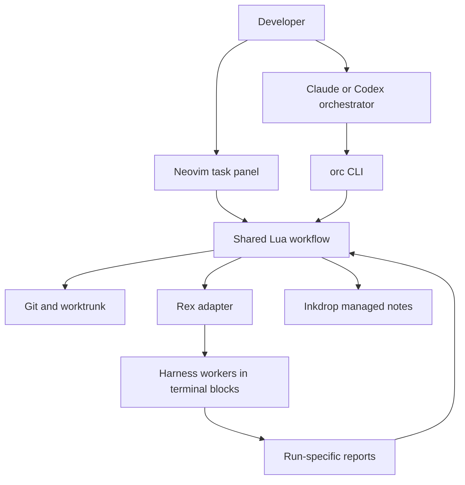

# Architecture

## Responsibilities

The harness makes decisions using canonical Markdown roles, rules and skills.
The Lua workflow manages identities, files, subprocesses and reports. Rex owns
terminal processes, layout and events. Neovim renders state and invokes the same
workflow commands asynchronously. This is not an independent LLM agent loop.
Execution levels select Single (`default`), Cascade (`high`) or Critique (`max`)
in the injected context, with the launch level stored on worker records and shown
in picker rows; Claude `high`/`max` share model routing while Codex selection stays native.

## Runtime

Neovim's Lua 5.1 environment supplies JSON, filesystem and libuv process support.
The executable resolves its own real path, so a symlinked CLI can find its modules
without changing the caller's working directory. Hooks run without user plugins,
write machine-readable stdout and send diagnostics to stderr.

The `UserPromptSubmit` context hook checks only a 512 KiB transcript tail for the
latest main-thread input usage (Claude usage plus cache tokens, or Codex rollout
`event_msg` / `token_count` → `info.last_token_usage.input_tokens`). It emits a
user warning and orchestration context at `ORC_CONTEXT_WARN` (default 200000);
`0` disables it and workers skip it. Missing or unusable usage produces no output.

Captured commands receive an argv list. Interactive harnesses inherit file
descriptors 0/1/2 and propagate exit/signal status. No shell is used to concatenate
user input into commands. Business modules accept a runtime adapter for tests.

Every Codex launch uses `--no-daemon` so hooks and model shell commands inherit
the launch's `ORC_*` and Rex identity variables. The shared app-server daemon can
retain another session's environment, preventing worker acknowledgement. Bypassing
it means no shared daemon MCP connections and slower startup.

`pane start --transport exec` opts Codex workers into a Lua runner in the owned
Rex block: `orc worker-run <record-file>`. `providers.plan` builds the same
scrubbed environment and role sandbox with `codex --no-daemon exec --json`.
The prompt keeps the run marker and hook/report protocol. TUI remains the default
for both providers and for records written before the transport field existed.

The runner tees stdout bytes to `<checkout>/.orc/runs/<runId>.jsonl`, emits short
event summaries, and reports root `app=orc` working/done/error states using
[OSC 7501](https://www.superlogical.com/rex/docs/build/program-status).
Thread identity, last-turn usage, exit status and rate-limit detection use the
same atomic state lock and run-ID checks as hooks and snapshots. Terminal
metadata survives concurrent hook updates; a closed record stays closed.
An exec usage/rate limit takes precedence over native status and `pane wait`
returns `rate-limited` with an alternate-provider restart hint. Exec does not
send stdin or answer approvals. `pane prompt` rejects exec workers; resume with
a new Rex block is deferred, so close/start creates a fresh thread.

The [Codex JSONL event definitions at 0.167.0](https://github.com/openai/codex/blob/rust-v0.167.0/codex-rs/exec/src/exec_events.rs)
define top-level `error.message`, nested `turn.failed.error.message`,
`thread.started.thread_id` and `turn.completed.usage`. These shapes were checked
alongside local `codex exec --help` and `codex exec resume --help`; no paid model
smoke is part of ordinary validation.

## Identity and recovery

Every assignment has a distinct `runId`. A durable record associates its feature,
task and worktree with the Rex server/session/block and acknowledged prompt.
The record's block ID, not its label, identifies a terminal the workflow may close.
If a create response is lost, Orc uses a run-specific label to locate candidates
and verifies the Rex server, terminal and worker process before saving the block
ID. Retrying an unresolved launch checks the same run for its pane.
After reconnect, events trigger a fresh snapshot rather than assuming missed events
can be replayed.

Process state, self-reported program state and reviewed task outcome are separate.
Unknown delivery stays unconfirmed until the receiving harness acknowledges it;
retrying an ambiguous send must not type a duplicate prompt. Report validation
checks the current run ID and required sections. Only the orchestrator accepts
work after reading the diff and rerunning the task's validation.
For a saved independent review, `pane review-begin` binds a new report path to the
current run and Git fingerprint, writes `<review-file>.diff`, and returns its
absolute path as `package`. The package includes the checkout status, stat and
patch, with untracked files shown as additions. A clean task branch uses its
commit log, stat and patch against its base. An empty review or an unreadable or
pre-judging `--prompt` file prevents the pin and package from being created.
The report and package paths must be outside the task checkout or Git-ignored.
`pane close --review` checks the pin against the current checkout and the chosen
report after the orchestrator reads the verdict.

`pane start` guards the checkout's own git toplevel (`--allow-subdir` is explicit),
including `--here` starts in another repository. `--precheck` runs via `sh -c`
before pane or record creation; failure includes its exit code and last 40 output lines.
Queued TUI prompts retain process/owner and hook revision checks, submit using
Codex Tab or Claude Enter, and await the next run's UserPromptSubmit acknowledgment.
Runs on one worker record form a single compare-and-swap chain, so `pane wait`
follows a follow-up to the newest run and reports replaced runs in `previousRuns`.
`wait --until report` ignores missing-evidence stops; plain wait exposes them as
`turn-ended-no-report`. Native user-action blocks remain distinct from turn endings.
Both wait modes return `unacknowledged` with a recovery hint after 60 seconds
without prompt acknowledgment. For queued prompts, the window starts when Rex
reports the running turn as `idle` or `done`.
Native `working` clears an observed hook block after an auto-resolved permission.

`orc diagnose <feature> [--json]` reads the main checkout's worker records,
Codex and Claude transcripts, available exec logs, and guard denies within the
feature's observed time window. It counts runs, turns, tool calls, failures and
tokens, and measures elapsed time from the earliest and latest recorded
timestamps. Totals group workers by role and last recorded model. For a run
identified in both sources, the rollout supplies the counts. Codex uses
`input_tokens`, which already includes cached input. Claude sums `input_tokens`,
`cache_read_input_tokens`, and `cache_creation_input_tokens` once per assistant
message ID. Both providers use `output_tokens` for output. Stumbles cite the
source path and line, with command previews capped at 80 characters. Raw prompts,
tool output and file contents stay in their source files. JSON reports use
`schemaVersion: 1`.

The shared main checkout's `.orc/validation.md` is optional project memory and is
injected into implementer prompts. Workers run edit/task tiers. The orchestrator
runs the gate tier on the integrated tree before commit through `orc gate`. The
gate uses an exclusive private machine-wide JSON lock with owner metadata,
sleeps between polls, recovers
dead pids and pre-boot owners, streams both output channels and releases on
command/error/handled exit.

Use Worktrunk project hooks in `.config/wt.toml` as the deterministic gate before
agent review: an approved `pre-merge` hook runs the project's validation and
aborts `orc wt merge` on failure. A `post-start` hook running
`wt step copy-ignored` copies ignored build caches from the primary worktree in
the background when a worktree is created. Hook names, location and lifecycle
were verified against Worktrunk v0.81.0's `wt --help` and `wt hook --help` and its
[hook documentation](https://worktrunk.dev/hook/); see the
[recommended configuration](../README.md#worktrunk-project-hooks).

## Permissions

The workflow never answers trust or approval dialogs. Restricted roles do not
receive the orchestrator's shared Git-directory access. Hook command guards prevent
accidental workflow violations; they are not a security sandbox against arbitrary
same-user programs or access to a terminal server. Real restrictions come from the
harness/OS sandbox and available credentials.

The command guard blocks restricted roles from changing the Git stash shared by all worktrees.
It also warns the main Claude agent, without blocking, when a top-level `cd` targets a
folder other than `$CLAUDE_PROJECT_DIR`, because that `cd` persists in its shell; `cd` inside
`( )` or `$( )` runs in a subshell and does not warn.
Restricted roles may rename the current Rex session, which worker panes share with the
orchestrator, with `rex session rename <label>`; other Rex control commands stay with the
orchestrator.

## Persistence and external interfaces

Plans and managed-note links belong to the main checkout; task reports belong to
their run-specific paths. Task status uses the matching worker's report status; there
is no shared checkout report copy. Worker scans skip mismatched record identities and
status warns with their paths; unreadable or invalid records remain errors.

Status assigns a task worktree to one feature by plan task ID, then by a worker
record for that checkout, then by a unique feature using the base branch. Tasks
with a worktree report its current branch. Status warns about unclaimed
task worktrees and entries in the stash shared by all worktrees. When all tasks
in a nonempty feature are merged or closed, it suggests moving the feature to
`.scratch/.archive/<feature>`. Warnings appear in JSON and on stderr in text mode.

State writes are atomic. No UI process is required for worker
liveness. JSON command fields keep their established schemaVersion 1 meaning,
with additive worker metadata for new clients.

Inkdrop requests use a five-second timeout (shorter for doctor), refuse redirects
and non-loopback hosts, and never expose credentials through argv or logs.
Revision conflicts retry once from a fresh GET, preserving edits outside the managed
block.

## Rex configuration and project views

Rex configuration remains the user's adapter for keybindings, popup placement
and originating client context. It launches public orc Neovim entrypoints rather
than importing Neovim modules into the server's Lua host. The project picker owns
its create/select/retry flow; the shared Rex adapter owns transport and server
identity. snacks.nvim is required only by project search.

Task focus selects recorded session/block IDs and the originating app when known.
View shutdown never controls worker/session or Inkdrop service lifetimes. Existing
worker ownership and permission checks remain separate from UI selection.
See [Rex integration](rex-integration.md).

## Shared Inkdrop MCP

`providers.plan` is the shared launch interface for the orchestrator and Rex
workers. It returns native argv, cwd and explicit environment changes. Provider
transport configuration stays separate from process execution and task state.
The `inherit` default keeps existing MCP behavior; explicit `shared` mode checks
the endpoint/configuration and fails rather than starting another STDIO backend.

The user LaunchAgent owns mcp-proxy, and mcp-proxy owns one Inkdrop backend.
Worker/panel shutdown never controls that service. Installation, migration and
service start are explicit user operations. Config/credential reads, protocol
health checks and launchd mutations have separate interfaces and tests.

Inkdrop REST mirroring remains independent of MCP transport and can read the
same private credential source without exporting secrets to providers. HTTP
session separation does not provide per-user authorization, note-write
serialization or a workspace filesystem sandbox for attachment tools.
See [setup, migration and security limits](shared-inkdrop.md).
